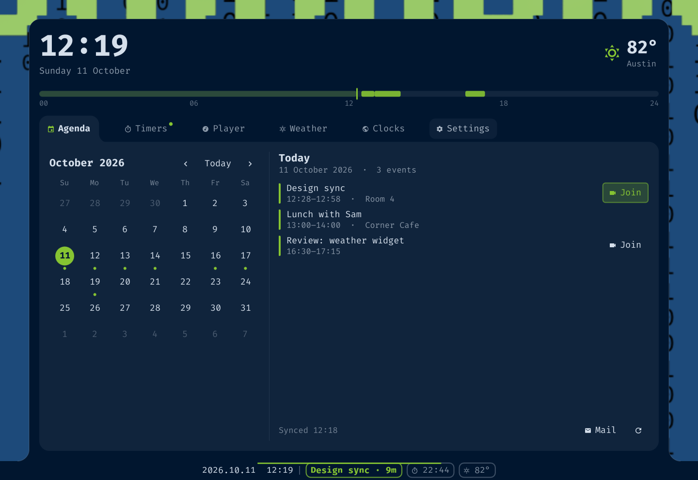

# Tidepool

A calm clock for the [Omarchy](https://omarchy.org) bar that carries the next thing on your
calendar, and opens into an agenda, a clock (world clocks, alarms, stopwatch, timers), media and weather.

It lives *in* the bar, replacing the clock, and draws everything with the bar's own colors and your
theme accent, so it blends in rather than sitting on top. The panel is a tab that grows out of the
bar edge, with the concave "rounded tab" corners of
[css-tip.com/rounded-tab](https://css-tip.com/rounded-tab/).



Tidepool started as a bar-resident, theme-colored take on the
[Nookisle](https://github.com/bavanchun/nookisle) island, and keeps its calendar-source model.

## What you get

**On the bar:** `[date and/or time] │ extras`

- The base is the time, the date, or both. Right-click the bar to cycle them.
- After a divider come up to four **extras**, each with its own switch: the next calendar event
  (`Standup · 12m`), a running timer, the playing track and the weather.
- Show 0–4 extras at once. If more are switched on than fit, they swap page by page with dots for
  the rest. Draw them plain, in a border, or as buttons.
- Click an extra to open the panel on its own tab. A heads-up notification fires a few minutes
  before each event, with the room and the call link.
- A hairline under the widget fills as the day passes, with a tick for every event.
- Hover for a peek at the next three events.

**In the panel:**

| Tab | |
| --- | --- |
| **Agenda** | Month grid and the day's events, or the next 3 / 7 / 14 / 30 days grouped by day. Events with a call link (Meet, Zoom, Teams, Webex…) get a **Join** button; click an event for its organizer, attendees and description. Buttons at the bottom open the web pages that go with the accounts you've added, in your default browser (Google: Calendar, Tasks and Gmail; Outlook: Calendar, To Do and Mail; iCloud: Calendar, Reminders and Mail; Fastmail: Calendar and Mail; Nextcloud: Calendar and Tasks), plus a Mail button for your mail app. |
| **World** | Your world clocks, chosen in Settings. |
| **Alarm** | A time of day with optional repeat days (or once), as systemd user timers that survive a shell restart and notify on their own. |
| **Stopwatch** | Start, lap and reset; it keeps running while the panel is closed, but not across a shell restart. |
| **Timer** | Presets, custom minutes and a pomodoro that can queue several focus/break cycles; they are real Omarchy reminders. |
| **Media** | Whatever is playing, in any MPRIS app: art, seek bar, shuffle, repeat, volume, an app list and a live audio spectrum with a ‹ style › switcher in its corner. Clicking an app brings its window to the front (it works for terminal players, native apps and browsers). If the chosen app has nothing playing, the tab says so and keeps the app list so you can pick another. |
| **Weather** | Current conditions and a 5-day forecast. |

A separate **Settings** window (the button after the tabs) holds every option. It has sections for the bar (Date & time, Bar extras, Appearance), one for each extra (Next event, Timer, Media, Weather), and for what the panel shows (Calendars, Agenda, World clocks). Bar extras holds the on/off switches for all the extras; each extra's own section starts with the same switch.

## Requirements

- Omarchy with the shell (`omarchy-shell`) and its plugin system.
- `python3` (standard library only).
- Optional: `cava` for the media spectrum, `secret-tool` (libsecret) to store CalDAV
  passwords, `omarchy-reminder` for timers (ships with Omarchy).

## Install

```sh
omarchy plugin add https://github.com/jgarza9788/omarchy-tidepool --enable
```

Then put it in the bar, in place of the clock. In `~/.config/omarchy/shell.json`, under
`bar.layout.center`, swap `{ "id": "omarchy.clock" }` for:

```json
{ "id": "jgarza.tidepool" }
```

and, to pin it to the middle of the bar, set `"centerAnchor": "jgarza.tidepool"` in `bar`.
The stock clock stays installed, so switching back is a one-line change.

Or clone by hand into `~/.config/omarchy/plugins/jgarza.tidepool`, run
`omarchy-shell shell rescanPlugins` and `omarchy plugin enable jgarza.tidepool`.

## Uninstall

```sh
omarchy plugin remove jgarza.tidepool
```

Then put `{ "id": "omarchy.clock" }` back in `bar.layout.center` (and drop `centerAnchor` if you
set it). Your calendar settings stay in `~/.config/jgarza.tidepool/` and `~/.local/state/jgarza.tidepool/`;
delete those folders to remove them, and any CalDAV passwords with
`secret-tool clear service tidepool`.

## Calendars

Add calendars in **Settings → Calendars**. Source types:

- **ICS file** and **calendar folder** (a directory of `.ics` files): a path.
- **iCal link**: any `https` feed. For Google Calendar use *Settings → your calendar →
  Secret address in iCal format*. There is no Google login.
- **CalDAV**: URL, user name and an app password. The password goes to the system keyring
  (`secret-tool`, service `tidepool`) and is never written to a file.

Safety rules: `https` only (or `http://localhost`); no credentials inside URLs; private and local
addresses (including Tailscale's `100.64.0.0/10`) are blocked unless you tick *Allow local network*
on that source; redirects are re-checked against the same rules, the address actually connected to is checked too (so a DNS trick cannot reach your LAN), and a login is never sent to a different host after a redirect.

Event details (description, organizer, attendees) and the call link come straight from the feed; nothing is sent anywhere. Links are only opened when you click them, and only `http(s)` and `mailto:` are ever handed to the desktop.

Sources and agenda options are stored in `~/.config/jgarza.tidepool/settings.json` (mode 0600).

The bar widget's own options live in `shell.json`, and the shell rewrites that entry when the plugin is switched off and on. So a copy is kept in `~/.config/jgarza.tidepool/widget-settings.json` (mode 0600), refreshed whenever the options change; if the entry ever comes back with nothing in it, the widget restores them from that copy. To really reset to defaults, delete that file as well as the options in `shell.json`.
*Import from Nookisle* copies sources from `~/.config/nookisle/settings.json`.

## Options

Everything has a switch in the Settings window. They are also plain keys on the widget's entry in
`shell.json`:

| Key | Default | |
| --- | --- | --- |
| `clockMode` | `time` | `time`, `date` or `both` |
| `format`, `dateFormat` | `HH:mm`, `ddd d MMM` | Qt date formats |
| `showEvent` `showTimer` `showMedia` `showWeather` | `true` `true` `false` `false` | which extras appear |
| `showMediaStatus`, `miniVisualizer` | `false` | play / pause icon on the media extra (it then stays while paused); a few live spectrum bars beside the track (needs `cava`) |
| `visualizerStyle` | `bars` | `bars`, `mirror`, `dots` (a grid of translucent dots that swell and overlap with the sound), `wave`, `line`, `fire` (flickering pixel flames in the accent and its neighbouring colors) or `none` (visualizer off, and `cava` does not run): how the spectrum is drawn, in the Media tab and on the bar |
| `visualizers` | `bars,mirror,wave,line` | which styles you can pick from (the style picker and the Media tab's switcher). `dots` and `fire` start off (a style you had already chosen stays on). They are drawn by a fragment shader on the GPU, so they are cheap; if the shader can't load they fall back to a slower CPU drawing |
| `extrasShown` | `4` | how many extras at once (0 hides them and the divider) |
| `extraStyle` | `plain` | `plain`, `border` or `button` |
| `rotateSeconds` | `6` | seconds per page when extras swap |
| `soonMinutes` | `15` | events this close are drawn in the accent color |
| `notifyMinutes` | `5` | desktop notification this many minutes before an event (0 = off) |
| `chipHorizonHours`, `chipMaxChars` | `12`, `22` | when the event chip appears, and how long its title may be |
| `peekOnHover`, `tideLine` | `true` | hover peek, day-progress line |
| `weekStart` | `monday` | month grid |
| `weatherCity`, `weatherLat`, `weatherLon`, `units` | | picked in Settings → Weather; `metric` or `imperial` |
| `worldClocks` | | comma-separated IANA zones, up to 6 |
| `timerPresets` | `5,15,25,45` | minutes |

Older names still work: the `showMusic` option, the `player` and `music` tab names, and the `music` settings section.

## Controls

| | |
| --- | --- |
| Left click | open the panel (or the extra's own tab if you click an extra) |
| Right click | cycle date / time / both |
| Middle click | open the timezone picker |
| `Tab` / `Shift+Tab`, `1`–`7` | switch tabs |
| `←` `→` · `[` `]` · `t` · `r` · `Esc` | agenda: day, month, today, sync; close |
| Media tab: `space` `n` `p` `s` `r` `+` `-` `v` | play/pause, next, previous, shuffle, repeat, volume, next visualizer (`V` for previous) |

Shell commands:

```sh
omarchy-shell jgarza.tidepool open|close|toggle|sync|cycleMode
omarchy-shell jgarza.tidepool tab agenda|clocks|alarm|stopwatch|timer|media|weather   (also: clock, alarms, timers)
omarchy-shell jgarza.tidepool settings [section]
omarchy-shell jgarza.tidepool app [name]        # make the Media tab follow an app; no name = automatic
omarchy-shell jgarza.tidepool timer <minutes> <label>
```

## Privacy and network

Tidepool talks to the network only for what you set up: your calendar URLs, and
[Open-Meteo](https://open-meteo.com) (no key) for weather and the city search. The time zone search is local.
Nothing else leaves your machine. Clocks, alarms, timers and media are local.

## Development

```text
BarWidget.qml  Store.qml  Panel.qml  TabPanel.qml  SettingsWindow.qml   the shell side
components/                                                              tabs, tab shapes, pickers
Model.js                                                                 pure logic (no QML)
lib/tidepool_helper.py  lib/ics.py                                       sync, weather, keyring
bin/tidepool-helper  bin/cava.conf                                       entry point, spectrum config
```

```sh
node tests/model.test.js                                # model
python3 -I -B -m unittest discover tests                # helper, ICS, and a CalDAV server round-trip
```

Quickshell caches compiled QML. If an edit seems to be ignored, run
`rm -rf ~/.cache/quickshell/qmlcache/*` and `omarchy restart shell`.

## Credits

[Nookisle](https://github.com/bavanchun/nookisle) for the calendar model and the idea,
[css-tip.com](https://css-tip.com/rounded-tab/) for the tab shape, Open-Meteo for weather data,
and the ICS reader borrowed from the earlier `jgarza.agenda`.

## License

MIT. See [LICENSE](LICENSE).
